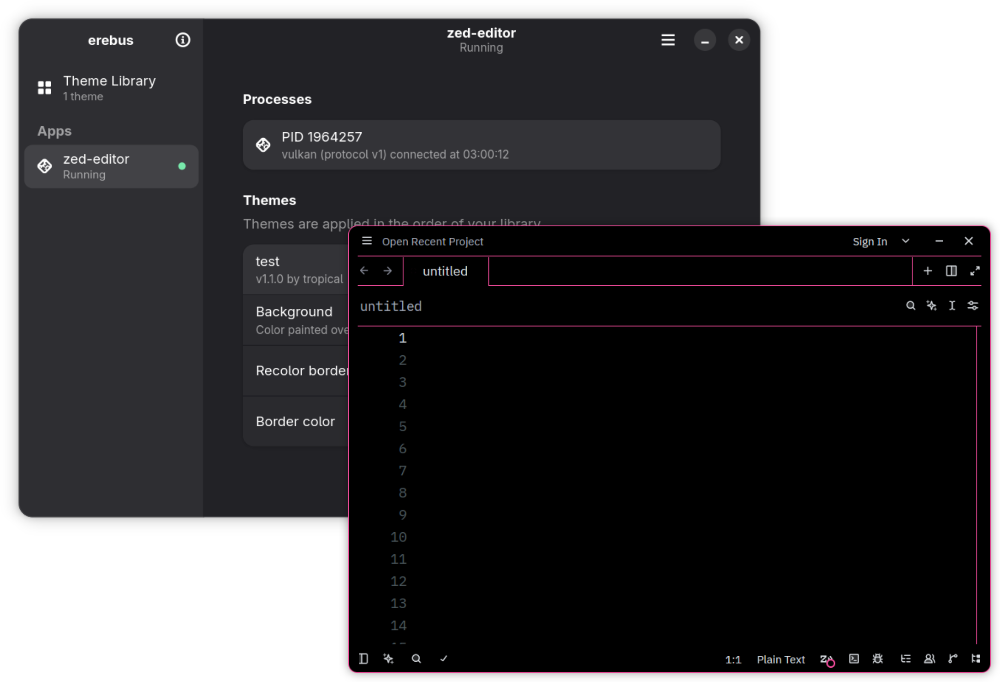
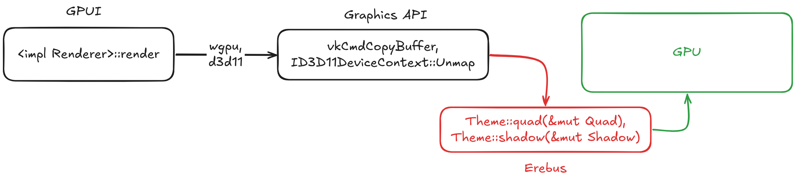

# erebus

erebus is a proof-of-concept for a theme engine that can style Rust GPUI applications *after compilation* in a non-intrusive and stable [(albeit limited)](#caveats) fashion. It does this by hooking low-level graphics APIs used by GPUI's renderer like Vulkan and D3D11.

<p align="center">
    
</p>

## Why?

Discord has [announced](https://x.com/svishnevskiy/status/2118081920194203799) that they are switching away from using [Electron](https://www.electronjs.org/) in their desktop client in favor of [GPUI](https://gpui.rs). This is a great net improvement for end-users, but it does pretty much kill the client modding scene, where people would modify Discord's JavaScript and CSS to load custom themes and plugins.

Given the recent surge of interest in the Rust UI ecosystem, I expect that more apps are going to be moving away from Electron, which is going to make these kinds of modifications much harder in the long run. You can't just inject your own code into Rust binaries, since Rust doesn't have a stable ABI (and likely never will). This means that even if you do string together an elaborate client modification for one version of an app, any update could break everything at any time if someone decided to bump `rustc`.

*We need a solution that can modify Rust apps without touching the Rust ABI.*

## How?

The C ABI, of course! C is the lingua franca of programming languages and, [for better or for worse](https://faultlore.com/blah/c-isnt-a-language/), has had a stable ABI for decades. Some parts of GPUI need to use the C ABI for various reasons. One of those parts is the [`Scene` system](https://github.com/zed-industries/zed/blob/main/crates/gpui/src/scene.rs).

In GPUI, a `Scene` is a complete plan for how to render a given frame of the application. It is built after the element tree has been evaluated right before data is uploaded to the GPU. And... that data uses the C ABI, because it has to when passing stuff to the GPU.

```rs
#[derive(Default, Debug, Copy, Clone)]
#[repr(C)] // <--- waow
#[expect(missing_docs)]
pub struct Quad {
    pub order: DrawOrder,
    pub border_style: BorderStyle,
    pub bounds: Bounds<ScaledPixels>,
    pub content_mask: ContentMask<ScaledPixels>,
    pub background: Background,
    pub border_color: Hsla,
    pub corner_radii: Corners<ScaledPixels>,
    pub border_widths: Edges<ScaledPixels>,
}
```

When a GPUI `Renderer` implementation needs to send off these scene primitives to the GPU, it places them in a *memory-mapped buffer*, which is a chunk of VRAM mapped to the address space of the CPU. Doing this process involves calling down to a lower-level graphics API. On Linux, this is done through the `wgpu` crate, which will eventually call Vulkan's `vkCmdCopyBuffer` function. On Windows, they use Direct3D 11 which has this happen in `ID3D11DeviceContext::Unmap`.

erebus intercepts these low-level graphics APIs and passes these `Scene` primitives to themes to modify before they reach the GPU. On Linux this is handled via a [Vulkan Layer](https://docs.vulkan.org/guide/latest/layers.html) (a small shared object that hooks functions exposed by the Vulkan API). On Windows, we use a technique [DLL Hijacking](https://www.upguard.com/blog/dll-hijacking) to load our own `d3d11.dll` inside of the app.

<picture>
  <source media="(prefers-color-scheme: dark)" srcset="assets/diagram-dark.png">
  <source media="(prefers-color-scheme: light)" srcset="assets/diagram-light.png">
  
</picture>

## Theme Format

Themes are sandboxed [WebAssembly binaries](https://en.wikipedia.org/wiki/WebAssembly) running in the [`wasmtime`](https://wasmtime.dev/) runtime. A theme exports a set of functions for modifying paint primitives which is then called by the host erebus backend. The high-level Rust API currently looks like this:

```rs
struct TestTheme;

impl Theme for TestTheme {
    const NAME: &str = "example";
    const AUTHOR: &str = "tropical";
    const DESCRIPTION: &str = "meow";
    const VERSION: Version = Version::new(1, 0, 0);

    fn quad(&mut self, quad: &mut Quad) {
        quad.background = Background::solid(Hsla::from_rgb(0, 0, 0));
    }
}

erebus_theme::export_theme!(TestTheme);
```

`erebus` also technically supports writing themes in other languages like C through a lower-level theme ABI.

## Try It

First, compile the example theme.

```sh
cargo build -p example-theme --target=wasm32-unknown-unknown --release
```

This will give you a theme file in `target/wasm32-unknown-unknown/release/example_theme.wasm`.

### Linux

> [!IMPORTANT]
> You will need a GPU that supports Vulkan, otherwise `wgpu` will fallback to its OpenGL backend and erebus won't work.

The example below injects into `zed` and should color everything black. You should be able to exchange `zed` for any GPUI app and get the same result.

```sh
cargo build -p erebus-vulkan --release
VK_LAYER_PATH=. VK_INSTANCE_LAYERS=VK_LAYER_erebus EREBUS_THEME=./target/wasm32-unknown-unknown/release/test_theme.wasm zed
```

### Windows

> [!IMPORTANT]
> You will need an installation of [MSVC build tools](https://learn.microsoft.com/en-us/cpp/overview/acquire-msvc?view=msvc-170) in your `Path` environment variable to build erebus for Windows, since we do some DLL shenanigans in the postbuild.

First, make a copy of `C:\Windows\System32\d3d11.dll` named `d3d11_orig.dll` and place it in the same folder as the executable you want to inject into.

After that, build erebus with this command:

```sh
cargo build -p erebus-d3d11 --release
```

This will generate a `d3d11.dll` file in `target/release/`, which you should also move to the same folder as your executable. Your final folder layout should contain your executable, `d3d11_orig.dll`, and the `d3d11.dll` that erebus built. You can then launch the executable with the `EREBUS_THEME` environment variable pointing to a theme binary.

## Caveats

Because themes operate on drawing primitives after the element tree has been evaluated, we don't get any semantic meaning to what we're themeing. This is distinctly different from something like CSS. There are no selectors, you're just modifying a list of paint operations. You can tell if a box being rendered is blue or red, but you can't tell if it's a button or a checkbox. This is a fundamental limitation of this system (and GPUI as a whole; it has no concept of a selector). I don't have a solution for this, and I don't think there is one without touching the Rust ABI.
